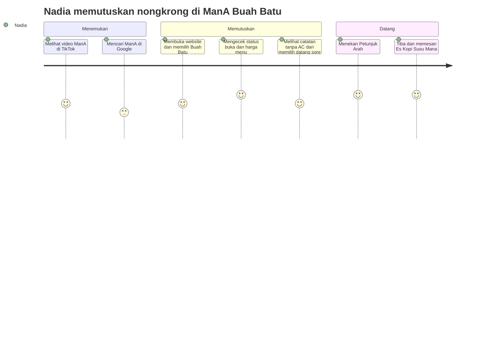
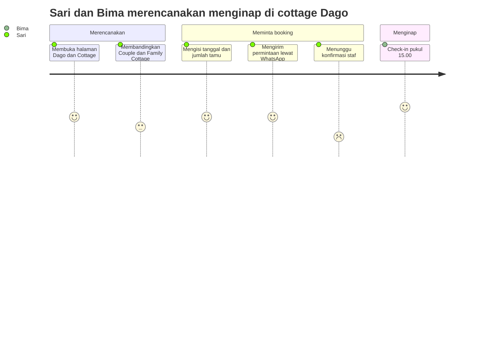
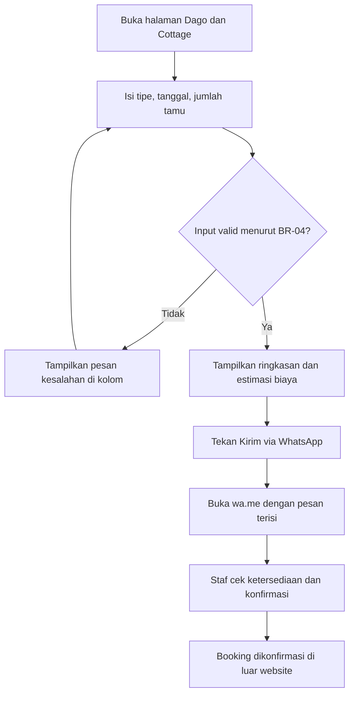
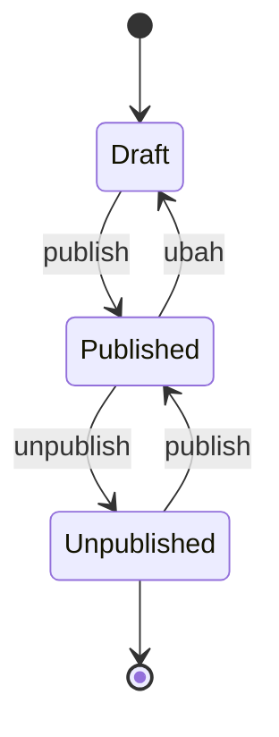
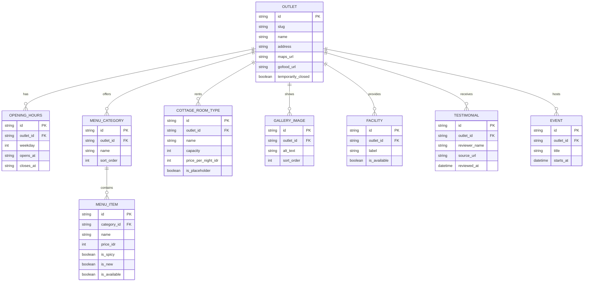
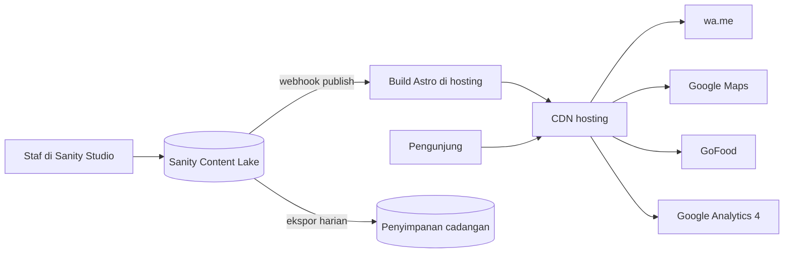

# Website ManA Social Cafe: Product Requirements Document

| Key | Value |
|-----|-------|
| Product | Website landing page ManA Social Cafe (Buah Batu dan Dago termasuk cottage) |
| Version | 1.1 |
| Date | 2026-11-26 |
| Status | Draft |
| Tier | Standard |
| Language | Bahasa Indonesia |
| Author | Tim proyek website ManA, disusun bersama Claude |
| Dokumen sumber | ManA Social Cafe Bandung: Business Research & Website Discovery (26 Nov 2026); Menu Digital ManA Social Cafe (PDF, 14 Jun 2026); logo manA Social Cafe (PNG) |

## Daftar isi

- [0. Ringkasan](#0-ringkasan)
- [1. Masalah dan konteks](#1-masalah-dan-konteks)
- [2. Tujuan dan metrik keberhasilan](#2-tujuan-dan-metrik-keberhasilan)
- [3. Pengguna dan persona](#3-pengguna-dan-persona)
- [4. Cakupan](#4-cakupan)
- [5. Kebutuhan fungsional](#5-kebutuhan-fungsional)
- [6. Aturan bisnis](#6-aturan-bisnis)
- [7. Spesifikasi fitur](#7-spesifikasi-fitur)
- [8. Desain UX dan UI](#8-desain-ux-dan-ui)
- [9. Perjalanan pengguna dan alur](#9-perjalanan-pengguna-dan-alur)
- [10. Kebutuhan non-fungsional](#10-kebutuhan-non-fungsional)
- [11. Model data](#11-model-data)
- [12. Spesifikasi antarmuka](#12-spesifikasi-antarmuka)
- [13. Arsitektur dan pedoman teknis](#13-arsitektur-dan-pedoman-teknis)
- [14. Keamanan dan privasi](#14-keamanan-dan-privasi)
- [15. Pengujian dan kualitas](#15-pengujian-dan-kualitas)
- [16. Operasional](#16-operasional)
- [17. Analitik dan telemetri](#17-analitik-dan-telemetri)
- [18. Rencana rilis](#18-rencana-rilis)
- [19. Risiko dan mitigasi](#19-risiko-dan-mitigasi)
- [20. Asumsi, dependensi, dan pertanyaan terbuka](#20-asumsi-dependensi-dan-pertanyaan-terbuka)
- [21. Matriks keterlacakan](#21-matriks-keterlacakan)
- [22. Glosarium](#22-glosarium)
- [23. Changelog](#23-changelog)

---

## 0. Ringkasan

Website mobile-first untuk merek ManA Social Cafe yang menjadi satu sumber resmi untuk dua outlet: Buah Batu (kafe kota) dan Dago (kafe view dengan 6 cottage). Saat ini informasi publik tentang ManA tersebar di blog 2023 dan direktori yang mencampur kedua outlet, dengan lima versi jam buka. Rilis v1 berisi pemilih outlet, jam dan status buka, petunjuk arah, menu resmi 2026, galeri, fasilitas, tombol WhatsApp, info dan permintaan booking cottage, serta editor konten untuk staf. Keberhasilan diukur dari klik Petunjuk Arah, klik WhatsApp, dan klik booking cottage dalam 60 hari setelah rilis. Data cottage di dokumen ini masih DUMMY dan wajib diganti sebelum produksi (BR-06).

## 1. Masalah dan konteks

### 1.1 Masalah

- **Tidak ada sumber resmi yang bisa dicari di Google.** ManA belum punya website; informasi resmi hanya ada di bio Instagram @mana.bandung (sekitar 57 ribu pengikut) [Confirmed, laporan riset bagian 6].
- **Data publik usang dan bertentangan.** Jam buka beredar dalam lima versi (12.00–22.00, 08.00–23.00, 09.00–22.00, 11.00–21.00 untuk delivery). Daftar menu terlengkap di internet berasal dari Juni 2023, sementara menu 2026 sudah berubah: bir dan dimsum dihapus, harga Es Kopi Susu Mana naik dari Rp20.000–26.000 menjadi Rp28.000 [Confirmed, laporan riset bagian 3–4].
- **Dua outlet tercampur.** Merek memakai setidaknya lima nama (ManA Social Cafe, ManA Social Space, ManA Social House, ManA Cafe & Cottage, Mana Foo & Cof), dan ringkasan direktori menempelkan deskripsi Dago ke profil Buah Batu [Confirmed].
- **Ekspektasi pengunjung tidak dikelola.** Keluhan berulang di ulasan Google: panas karena tanpa AC, asap rokok di lantai 1, parkir mobil terbatas [Confirmed].
- **Cottage Dago tidak punya kanal booking sendiri.** Satu-satunya listing publik ada di Trip.com [Confirmed].

Dampaknya, calon pengunjung bisa datang di jam yang salah, mengharapkan menu yang sudah tidak ada, atau batal datang karena tidak tahu fasilitas [Assumed].

### 1.2 Mengapa sekarang

Menu digital baru (Juni 2026) dan identitas visual sudah siap, sehingga konten inti tersedia [Confirmed]. Koridor Buah Batu padat kafe sekelas, dan baru satu pesaing (Monday Coffee) yang punya website [Confirmed]. Website yang rapi memberi pembeda di pencarian Google lokal sebelum pesaing lain menyusul [Assumed].

### 1.3 Alternatif

| Alternative | Kekuatan | Kekurangan | Source |
|-------------|----------|------------|--------|
| Bio Instagram @mana.bandung | Audiens besar, konten visual dari pengunjung | Tidak terindeks Google, tidak memuat menu atau harga, dua outlet dalam satu bio | Confirmed (laporan riset) |
| Profil Google Maps | Rating 4,7 (835 ulasan) Buah Batu, 4,6 (1.895 ulasan) Dago | Jam dan deskripsi bisa diubah pihak lain, tidak ada menu lengkap | Confirmed (Wanderlog) |
| Blog dan direktori pihak ketiga | Banyak dan mudah ditemukan | Data 2023, mencampur outlet, nomor kontak keliru | Confirmed |
| Website pesaing mondayco.id | Menu, lokasi per cabang, FAQ, blog | Tanpa tombol WhatsApp, reservasi, atau tautan delivery; jam di hero bertentangan dengan jam per cabang | Confirmed (mondayco.id, diakses 26 Nov 2026) |

### 1.4 Rencana validasi

- Dua minggu sebelum rilis: 5 pengunjung nyata di outlet Buah Batu mencoba prototipe di ponselnya dan diminta menemukan jam buka, harga Es Kopi Susu Mana, dan tombol WhatsApp. Lulus jika minimal 4 dari 5 menyelesaikan ketiganya tanpa bantuan [Suggested].
- 30 dan 60 hari setelah rilis: bandingkan klik Petunjuk Arah, WhatsApp, dan booking cottage dengan target di bagian 2 [Suggested].
- Tanyakan di kasir selama 2 minggu pertama: "Tahu ManA dari mana?" dengan pilihan Instagram, TikTok, Google, website, teman [Suggested].

## 2. Tujuan dan metrik keberhasilan

Belum ada data trafik, jadi semua baseline "unknown" dan target bersifat Assumed. Target ditinjau ulang 30 hari setelah rilis.

| ID | Tujuan | Metrik | Baseline | Target | Timeframe | Source |
|----|--------|--------|----------|--------|-----------|--------|
| G-01 | Mendorong kunjungan langsung ke kedua outlet | Jumlah event `click_directions` per bulan (dua outlet digabung) | unknown | 300 per bulan | Bulan kedua setelah rilis | Assumed |
| G-02 | Mendorong reservasi grup dan pertanyaan lewat WhatsApp | Jumlah event `click_whatsapp` per bulan | unknown | 60 per bulan | Bulan kedua setelah rilis | Assumed |
| G-03 | Menghasilkan permintaan booking cottage Dago | Jumlah event `submit_cottage_request` per bulan | unknown | 20 per bulan | Bulan kedua setelah rilis | Assumed |
| G-04 | Menjadi sumber informasi resmi di Google | Posisi website di Google untuk "ManA Social Cafe" dan "mana cafe buah batu" | Tidak ada website | Posisi 1–3 untuk kedua kata kunci | 60 hari setelah rilis | Assumed |
| G-05 | Menjaga konten tetap akurat | Selisih jam dan harga antara website, menu cetak, dan Google Business Profile | 5 versi jam beredar | 0 selisih pada audit bulanan | Setiap bulan sejak rilis | Suggested |
| G-06 | Menambah pesanan delivery | Jumlah event `click_gofood` per bulan | unknown | 40 per bulan | Bulan kedua setelah rilis | Assumed |

**Non-goals:** website tidak menerima pembayaran, tidak menjadi sistem pemesanan makanan, tidak menyimpan data pelanggan, dan tidak menggantikan Instagram sebagai kanal konten harian.

## 3. Pengguna dan persona

| ID | Persona | Tujuan | Pain points | Konteks penggunaan | Source |
|----|---------|--------|-------------|--------------------|--------|
| P-01 | Nadia, 22, mahasiswi, "Nongkrong Aesthetic" | Menemukan tempat yang enak difoto dengan harga sesuai kantong | Tidak tahu harga sebelum datang; panas di siang hari; antre akhir pekan | Ponsel Android, dari TikTok atau Instagram, 1–2 kali per minggu | Assumed (dari laporan riset bagian 8) |
| P-02 | Raka, 27, desainer freelance, "WFC Seharian" | Tempat kerja dengan colokan, WiFi, dan kopi | Asap rokok; tidak ada info WiFi dan colokan | Ponsel lalu laptop, cari di Google, 2–3 kali per minggu, 3 jam per kunjungan | Assumed |
| P-03 | Dimas, 30, koordinator komunitas, "Kumpul Rame-rame" | Tempat untuk 10–30 orang (nobar, buka puasa bersama) | Tidak tahu kapasitas dan cara reservasi grup | Ponsel, menghubungi lewat WhatsApp, sebulan sekali | Assumed |
| P-04 | Sari dan Bima, 29, pasangan dari Jakarta, "Staycation View Kota" | Menginap di cottage dengan view lampu kota | Tidak tahu tipe kamar, harga, dan cara booking selain OTA | Ponsel atau laptop, merencanakan 1–3 minggu sebelumnya, beberapa kali per tahun | Assumed |
| P-05 | Staf ManA, pengelola konten | Memperbarui menu, jam, promo, dan foto tanpa bantuan developer | Tidak punya latar teknis | Laptop di kantor atau kasir, mingguan | Confirmed (jawaban default pengguna, 26 Nov 2026) |

### 3.1 Peran dan izin

| Peran | Boleh | Tidak boleh |
|-------|-------|-------------|
| Pengunjung (publik) | Melihat semua halaman, membuka WhatsApp, Google Maps, GoFood, dan Instagram | Mengubah konten; tidak ada akun pengunjung |
| Editor konten (staf) | Membuat, mengubah, dan menerbitkan menu, jam, foto, promo, FAQ, data cottage | Menghapus outlet, mengubah pengaturan situs, mengelola pengguna CMS |
| Administrator (pemilik atau developer) | Semua yang boleh Editor, ditambah pengaturan situs, nomor WhatsApp, pengguna CMS | Tidak ada batasan di CMS |

## 4. Cakupan

### 4.1 Dalam cakupan

- Satu website merek dengan dua outlet: Buah Batu dan Dago, termasuk 6 cottage di Dago [Confirmed].
- Menu resmi Buah Batu dari menu digital Juni 2026 [Confirmed].
- Tombol WhatsApp ke nomor reservasi Buah Batu +62 857-2478-5388, dipakai sementara untuk semua outlet [Confirmed].
- Permintaan booking cottage yang membuka WhatsApp dengan pesan terisi [Confirmed, jawaban default pengguna].
- Editor konten (CMS) untuk staf [Confirmed].
- Bahasa Indonesia [Confirmed].

### 4.2 Di luar cakupan

- Pembayaran online dan deposit cottage: menambah kewajiban keamanan dan rekonsiliasi yang belum dibutuhkan.
- Pemesanan makanan untuk diantar: sudah ditangani GoFood.
- Akun pengunjung, program loyalitas, dan langganan newsletter.

### 4.3 Tidak di rilis ini

- Booking engine cottage dengan cek ketersediaan otomatis.
- Versi bahasa Inggris (fase 2, untuk tamu cottage luar kota).
- Menu outlet Dago, sampai datanya tersedia (Q-02).

### 4.4 Daftar fitur (MoSCoW)

Must berjumlah 14 dari 21 fitur (67%), di atas batas sehat 60%. Pemotongan yang diusulkan bila waktu tidak cukup: FR-13 (SEO terstruktur) turun ke Should dan dikerjakan di M-03.

| Fitur | Priority | FRs | Milestone |
|-------|----------|-----|-----------|
| Hero merek | Must | FR-01 | M-02 |
| Pemilih outlet | Must | FR-02 | M-02 |
| Jam buka dan status buka | Must | FR-03 | M-02 |
| Lokasi dan petunjuk arah | Must | FR-04 | M-02 |
| Menu Buah Batu | Must | FR-05 | M-02 |
| Galeri ruang | Must | FR-06 | M-02 |
| Fasilitas outlet | Must | FR-07 | M-02 |
| Tombol WhatsApp | Must | FR-08 | M-02 |
| Info cottage Dago | Must | FR-09 | M-02 |
| Permintaan booking cottage | Must | FR-10 | M-02 |
| Tautan media sosial | Must | FR-11 | M-02 |
| Editor konten | Must | FR-12 | M-01 |
| SEO lokal dan data terstruktur | Must | FR-13 | M-02 |
| Analitik dengan persetujuan cookie | Must | FR-21 | M-02 |
| Rekomendasi menu | Should | FR-14 | M-03 |
| Testimoni Google | Should | FR-15 | M-03 |
| Tentang ManA | Should | FR-16 | M-03 |
| Tautan GoFood | Should | FR-17 | M-03 |
| FAQ | Should | FR-18 | M-03 |
| Banner promo | Could | FR-19 | M-04 |
| Event dan komunitas | Could | FR-20 | M-04 |
| Booking engine cottage | Won't | - | - |
| Versi bahasa Inggris | Won't | - | - |

## 5. Kebutuhan fungsional

| ID | Kebutuhan | Priority | Goal | Stories | Source |
|----|-----------|----------|------|---------|--------|
| FR-01 | Beranda menampilkan logo manA Social Cafe dan satu kalimat positioning di hero, langsung diikuti pemilih outlet. Foto ruang tampil di panel outlet. Hero tidak memuat tombol; menu dibuka lewat navigasi utama | Must | G-01 | US-01 | Confirmed (laporan riset bagian 11); diubah di v1.1 (ADR 0001) |
| FR-02 | Beranda menampilkan pemilih outlet: dua chip (Buah Batu, Dago) dan satu panel untuk outlet yang dipilih, berisi nama, foto ruang, alamat, jam hari ini, status buka, fasilitas utama, tombol "Petunjuk Arah", tautan WhatsApp, dan tautan ke halaman outlet. Buah Batu terpilih secara bawaan | Must | G-01 | US-01 | Confirmed (keputusan cakupan 26 Nov 2026); diubah di v1.1 (ADR 0004) |
| FR-03 | Sistem menampilkan jam buka per outlet dari CMS dan menghitung status "Buka", "Segera tutup", atau "Tutup" sesuai BR-01 | Must | G-05 | US-02 | Confirmed |
| FR-04 | Setiap outlet punya tombol "Petunjuk Arah" yang membuka Google Maps ke alamat outlet, plus peta tersemat yang dimuat saat digulir ke area peta | Must | G-01 | US-03 | Confirmed |
| FR-05 | Halaman menu menampilkan 19 kategori dan 75 item menu Buah Batu dengan harga, deskripsi, penanda pedas, penanda menu baru, dan add-on, sesuai BR-02, plus tombol "Lihat menu versi PDF" yang membuka file menu PDF (URL dari SiteSettings) di tab baru | Must | G-05 | US-04 | Confirmed (menu digital Juni 2026); tautan PDF ditambahkan di v1.1 (ADR 0002) |
| FR-06 | Setiap outlet punya galeri foto ruang (minimal 6, maksimal 24 foto) dengan teks alternatif | Must | G-01 | US-05 | Confirmed (laporan riset bagian 7) |
| FR-07 | Setiap outlet menampilkan daftar fasilitas, termasuk yang tidak tersedia (misalnya "Tanpa AC") dan zona merokok | Must | G-01 | US-06 | Confirmed |
| FR-08 | Tombol WhatsApp melayang di semua halaman membuka wa.me dengan pesan terisi sesuai BR-03 | Must | G-02 | US-07 | Confirmed (nomor dari pengguna) |
| FR-09 | Halaman Dago menampilkan tipe cottage dengan kapasitas, harga per malam, fasilitas, dan aturan check-in/check-out | Must | G-03 | US-08 | Confirmed (cakupan); data DUMMY |
| FR-10 | Form permintaan booking cottage (tipe, tanggal check-in, tanggal check-out, jumlah tamu) memvalidasi input sesuai BR-04 lalu membuka WhatsApp dengan pesan terisi; tidak ada data yang disimpan | Must | G-03 | US-09 | Confirmed (jawaban default pengguna) |
| FR-11 | Footer dan halaman outlet menampilkan tautan Instagram @mana.bandung | Must | G-01 | US-10 | Confirmed |
| FR-12 | Staf dapat mengubah menu, jam, foto, fasilitas, data cottage, promo, dan FAQ lewat CMS tanpa kode; perubahan yang diterbitkan tayang dalam 10 menit | Must | G-05 | US-11 | Confirmed (jawaban default pengguna); target 10 menit Assumed |
| FR-13 | Setiap halaman punya judul, deskripsi, Open Graph, dan data terstruktur schema.org (CafeOrCoffeeShop untuk tiap outlet, LodgingBusiness untuk cottage, Menu untuk halaman menu) | Must | G-04 | US-12 | Suggested (diterima lewat GASSKEN) |
| FR-14 | Beranda menampilkan 4–6 item rekomendasi yang dipilih staf di CMS, dengan label dari menu ("Must Try", "New Menu") | Should | G-01 | US-14 | Suggested |
| FR-15 | Beranda menampilkan rating agregat Google per outlet dan 3 kutipan ulasan publik dengan nama pengulas dan tautan sumber, sesuai BR-07 | Should | G-04 | US-15 | Suggested |
| FR-16 | Bagian "Tentang ManA" menceritakan perjalanan dari Dago ke Buah Batu dengan teks dari pemilik | Should | G-04 | US-16 | Suggested |
| FR-17 | Halaman Buah Batu punya tombol "Pesan di GoFood" ke halaman merchant GoFood | Should | G-06 | US-17 | Confirmed (jawaban default pengguna) |
| FR-18 | Halaman FAQ menjawab minimal 8 pertanyaan: AC, rokok, colokan, WiFi, parkir, reservasi grup, pajak, hewan peliharaan | Should | G-01 | US-18 | Suggested |
| FR-19 | Banner promo tampil di beranda hanya selama periode aktif sesuai BR-05 | Could | G-01 | US-19 | Suggested |
| FR-20 | Bagian event menampilkan acara mendatang (nobar, movie night) dengan tanggal, outlet, dan tombol WhatsApp | Could | G-02 | US-20 | Suggested |
| FR-21 | Website mencatat event klik (bagian 17) di Google Analytics 4 hanya setelah pengunjung menyetujui cookie analitik | Must | G-01, G-02, G-03, G-06 | US-13 | Suggested (diterima lewat GASSKEN) |

## 6. Aturan bisnis

| ID | Aturan | Contoh | Berlaku untuk | Source |
|----|--------|--------|---------------|--------|
| BR-01 | Status buka dihitung dalam WIB (UTC+7) dari jam outlet hari itu. "Buka" jika jam sekarang di antara jam buka dan 30 menit sebelum tutup; "Segera tutup" jika 30 menit terakhir; selain itu "Tutup" dengan teks jam buka berikutnya. Jam tutup lewat tengah malam dihitung ke hari berikutnya | Buah Batu 08.00–23.00: pukul 22.40 tampil "Segera tutup, tutup pukul 23.00"; pukul 07.15 tampil "Tutup, buka pukul 08.00" | FR-02, FR-03 | Confirmed (jam); aturan 30 menit Suggested |
| BR-02 | Harga ditampilkan dalam format "Rp28.000" (titik pemisah ribuan, tanpa desimal) dan harus sama dengan menu cetak. Item tanpa harga di CMS tampil "Tanya barista". Website tidak menambahkan pajak atau service charge | Es Kopi Susu Mana 28000 tampil "Rp28.000"; Upside Cloud tanpa harga tampil "Tanya barista" | FR-05, FR-14 | Confirmed (menu digital); teks "Tanya barista" Suggested |
| BR-03 | Semua tautan WhatsApp memakai nomor dari pengaturan situs (saat ini 6285724785388) dan pesan terisi yang menyebut outlet serta asal "(dari website)" | Tombol umum di halaman Dago: "Halo ManA Dago, saya ingin bertanya. (dari website)" | FR-08, FR-10, FR-20 | Confirmed (nomor); template Suggested |
| BR-04 | Permintaan booking cottage valid jika: check-in paling cepat hari ini (WIB); check-out setelah check-in; lama menginap 1–14 malam; jumlah tamu 1 sampai kapasitas tipe kamar. Estimasi biaya = harga per malam x jumlah malam, ditandai "estimasi" | Family Cottage (kapasitas 4, Rp1.350.000 per malam DUMMY), check-in 2026-12-20, check-out 2026-12-22, 3 tamu: valid, 2 malam, estimasi Rp2.700.000 | FR-10 | Suggested (batas 14 malam Assumed) |
| BR-05 | Banner promo tampil hanya jika waktu sekarang (WIB) di antara `starts_at` dan `ends_at`. Jika lebih dari satu promo aktif, yang `starts_at`-nya paling baru yang tampil | Promo A 1–31 Des, Promo B 15–20 Des: pada 16 Des tampil Promo B, pada 21 Des tampil Promo A | FR-19 | Suggested |
| BR-06 | Konten bertanda `is_placeholder = true` (seperti data cottage DUMMY) tampil di lingkungan preview dengan label "Data contoh", dan build produksi gagal jika masih ada konten bertanda ini | Satu tipe cottage masih `is_placeholder = true`: build produksi berhenti dengan pesan "Masih ada 1 konten contoh: CottageRoomType Family Cottage" | FR-09, FR-10, FR-12 | Suggested |
| BR-07 | Testimoni hanya boleh berasal dari ulasan publik nyata, dengan nama pengulas sesuai sumber, tanggal, dan tautan ke ulasan aslinya. Teks boleh dipotong dengan tanda "...", tidak boleh diubah | Ulasan Google April 2026 tentang interior: tampil kutipan, nama pengulas, "April 2026", tautan "Lihat di Google" | FR-15 | Suggested |

## 7. Spesifikasi fitur

### 7.1 Hero dan pemilih outlet

Bagian pertama beranda memperkenalkan merek dan langsung meminta pengunjung memilih outlet, karena publik sering mencampur kedua outlet.

#### US-01: Memilih outlet dari beranda

- **Story:** Sebagai pengunjung baru (P-01), saya ingin melihat sekilas apa itu ManA dan memilih outlet, agar saya tidak salah datang ke lokasi.
- **Implements:** FR-01, FR-02 · **Screens:** S-01 · **Rules:** BR-01 · **Priority:** Must

**Acceptance criteria**

- **US-01.AC1:** Diberikan pengunjung membuka beranda di layar lebar 360 px, ketika halaman selesai dimuat, maka logo, kalimat positioning, dan navigasi utama terlihat tanpa menggulir, dan bagian pertama setelah hero adalah pemilih outlet "Mau ketemu di mana?". Hero tidak memuat tombol.
- **US-01.AC2:** Diberikan pengunjung membuka beranda, ketika bagian pemilih outlet tampil, maka ada tepat dua chip, "Buah Batu" dan "Dago", dengan chip "Buah Batu" aktif (`aria-pressed="true"`), dan satu panel berisi nama, alamat, jam hari ini, dan status buka Buah Batu.
- **US-01.AC3:** Diberikan pengunjung menekan chip "Dago", ketika panel berganti tanpa memuat ulang halaman, maka panel menampilkan alamat, jam hari ini, dan status buka Dago, chip "Dago" menjadi aktif, dan tautan "Lihat Dago dan Cottage" membuka halaman S-03 dengan judul "ManA Dago".

#### Kasus tepi dan status UI untuk 7.1

| Status | Pemicu | Perilaku | Pesan yang tampil |
|--------|--------|----------|-------------------|
| Foto ruang di panel outlet gagal dimuat | File foto tidak tersedia | Kotak cream berlabel nama outlet menggantikan foto | Tidak ada pesan |
| Outlet tutup sementara | Editor mengisi `temporarily_closed = true` | Panel outlet tetap tampil dengan status khusus | "Tutup sementara. Info terbaru di Instagram @mana.bandung." |
| JavaScript tidak berjalan | Skrip gagal dimuat atau dimatikan | Chip disembunyikan; panel kedua outlet tampil berurutan sehingga info tetap lengkap | Tidak ada pesan |

**Catatan:** kalimat positioning menunggu persetujuan pemilik (Q-12).

### 7.2 Jam buka dan status

#### US-02: Mengecek apakah outlet sedang buka

- **Story:** Sebagai pengunjung (P-02), saya ingin tahu apakah outlet sedang buka dan sampai jam berapa, agar saya tidak datang saat tutup.
- **Implements:** FR-03 · **Screens:** S-01, S-02, S-03 · **Rules:** BR-01 · **Priority:** Must

**Acceptance criteria**

- **US-02.AC1:** Diberikan jam Buah Batu 08.00–23.00 dan waktu sekarang Senin 10.00 WIB, ketika status Buah Batu tampil, maka teks status adalah "Buka, tutup pukul 23.00".
- **US-02.AC2:** Diberikan jam Buah Batu 08.00–23.00 dan waktu sekarang 22.40 WIB, ketika status Buah Batu tampil, maka teks status adalah "Segera tutup, tutup pukul 23.00".
- **US-02.AC3:** Diberikan waktu sekarang 07.15 WIB, ketika status Buah Batu tampil, maka teks status adalah "Tutup, buka pukul 08.00".
- **US-02.AC4:** Diberikan pengunjung berada di zona waktu selain WIB, ketika status dihitung, maka hasilnya tetap memakai WIB.

#### Kasus tepi dan status UI untuk 7.2

| Status | Pemicu | Perilaku | Pesan yang tampil |
|--------|--------|----------|-------------------|
| Jam belum diisi | Hari tertentu kosong di CMS | Status tidak ditampilkan, hanya teks jam | "Jam hari ini belum tersedia. Tanyakan lewat WhatsApp." |
| JavaScript nonaktif | Browser tanpa JS | Tampilkan tabel jam mingguan tanpa status | Tidak ada pesan |

**Catatan:** status dihitung di browser agar selalu sesuai waktu sekarang; halaman statis tetap memuat tabel jam lengkap.

### 7.3 Lokasi dan petunjuk arah

#### US-03: Mendapat petunjuk arah ke outlet

- **Story:** Sebagai pengunjung (P-01), saya ingin membuka petunjuk arah ke outlet yang saya pilih, agar saya bisa langsung berangkat.
- **Implements:** FR-04 · **Screens:** S-02, S-03 · **Priority:** Must

**Acceptance criteria**

- **US-03.AC1:** Diberikan pengunjung di halaman Buah Batu, ketika ia menekan "Petunjuk Arah", maka tab baru membuka Google Maps dengan tujuan "ManA Social Cafe, Jl. Buah Batu No.127, Bandung 40265".
- **US-03.AC2:** Diberikan pengunjung di halaman Dago, ketika ia menekan "Petunjuk Arah", maka tujuan Google Maps adalah "Jl. Cibengang No.21, Ciburial, Cimenyan".
- **US-03.AC3:** Diberikan halaman outlet dimuat, ketika pengunjung belum menggulir ke area peta, maka peta tersemat belum dimuat (tidak ada permintaan jaringan ke Google Maps).
- **US-03.AC4:** Diberikan tombol "Petunjuk Arah" ditekan, ketika pengunjung sudah menyetujui cookie analitik, maka event `click_directions` tercatat dengan properti `outlet`.

#### Kasus tepi dan status UI untuk 7.3

| Status | Pemicu | Perilaku | Pesan yang tampil |
|--------|--------|----------|-------------------|
| Peta gagal dimuat | Google Maps tidak merespons | Area peta diganti alamat teks dan tombol "Petunjuk Arah" tetap aktif | "Peta tidak dapat dimuat. Gunakan tombol Petunjuk Arah." |

**Catatan:** jalan ke Dago menanjak dan sempit (ulasan Google); halaman Dago memuat catatan akses dari pemilik (Q-01).

### 7.4 Menu Buah Batu

Menu disalin dari menu digital Juni 2026: 19 kategori, 75 item, Rp13.000–57.000 [Confirmed].

#### US-04: Melihat menu dan harga

- **Story:** Sebagai pengunjung (P-01), saya ingin melihat menu dan harga sebelum datang, agar saya bisa memperkirakan biaya.
- **Implements:** FR-05 · **Screens:** S-04 · **Rules:** BR-02 · **Priority:** Must

**Acceptance criteria**

- **US-04.AC1:** Diberikan data menu Juni 2026 sudah dimasukkan ke CMS, ketika pengunjung membuka halaman menu, maka tampil 19 kategori dan 75 item dengan harga sesuai menu cetak.
- **US-04.AC2:** Diberikan pengunjung menekan nama kategori "Coffee: Kopsu Series" di navigasi kategori, ketika halaman bergulir, maka judul kategori itu berada di atas layar dan navigasi menandai kategori tersebut aktif.
- **US-04.AC3:** Diberikan item ditandai pedas di CMS, ketika item tampil, maka ada ikon pedas dengan teks alternatif "Pedas".
- **US-04.AC4:** Diberikan item tanpa harga (Upside Cloud), ketika item tampil, maka posisi harga berisi "Tanya barista".
- **US-04.AC5:** Diberikan URL menu PDF tersimpan di SiteSettings, ketika pengunjung menekan "Lihat menu versi PDF", maka URL itu terbuka di tab baru.

#### Kasus tepi dan status UI untuk 7.4

| Status | Pemicu | Perilaku | Pesan yang tampil |
|--------|--------|----------|-------------------|
| Item tidak tersedia | Editor mengisi `is_available = false` | Item tetap tampil abu-abu dengan label | "Sedang tidak tersedia" |
| URL menu PDF kosong | Administrator mengosongkan URL di SiteSettings | Tombol "Lihat menu versi PDF" disembunyikan | Tidak ada pesan |
| Kategori kosong | Semua item kategori disembunyikan | Kategori tidak tampil di navigasi dan daftar | Tidak ada pesan |
| Menu Dago dibuka | Pengunjung di halaman Dago menekan "Menu" | Tampil catatan, bukan menu Buah Batu | "Menu ManA Dago sedang disiapkan. Tanyakan menu hari ini lewat WhatsApp." |

**Catatan:** foto produk dari menu digital dipakai jika pemilik mengizinkan (Q-07).

### 7.5 Galeri dan fasilitas

#### US-05: Melihat suasana ruang

- **Story:** Sebagai pengunjung (P-01), saya ingin melihat foto ruang outlet, agar saya tahu suasananya sebelum datang.
- **Implements:** FR-06 · **Screens:** S-02, S-03 · **Priority:** Must

**Acceptance criteria**

- **US-05.AC1:** Diberikan outlet punya 12 foto galeri di CMS, ketika halaman outlet dibuka, maka galeri menampilkan 12 foto, masing-masing dengan teks alternatif yang tidak kosong.
- **US-05.AC2:** Diberikan pengunjung menekan satu foto, ketika tampilan penuh terbuka, maka foto dapat digeser ke kiri dan kanan dan ditutup dengan tombol "Tutup" atau tombol Escape.

#### US-06: Mengecek fasilitas

- **Story:** Sebagai pekerja remote (P-02), saya ingin mengecek fasilitas seperti colokan, WiFi, dan zona merokok, agar saya tahu outlet cocok untuk bekerja.
- **Implements:** FR-07 · **Screens:** S-02, S-03 · **Priority:** Must

**Acceptance criteria**

- **US-06.AC1:** Diberikan halaman Buah Batu, ketika bagian fasilitas tampil, maka ada item WiFi, stopkontak, mushola, toilet, zona merokok lantai 1, area tanpa rokok lantai 2, dan "Tanpa AC".
- **US-06.AC2:** Diberikan fasilitas bertanda `is_available = false`, ketika tampil, maka ikon dan teks menyatakan "Tidak tersedia", tidak hanya dibedakan lewat warna.

#### Kasus tepi dan status UI untuk 7.5

| Status | Pemicu | Perilaku | Pesan yang tampil |
|--------|--------|----------|-------------------|
| Galeri di bawah 6 foto | Foto belum diunggah | Bagian galeri disembunyikan | Tidak ada pesan |
| Foto gagal dimuat | File rusak | Kotak foto diganti warna #ECE7AA dengan teks alternatif | Tidak ada pesan |

### 7.6 WhatsApp dan media sosial

#### US-07: Menghubungi lewat WhatsApp

- **Story:** Sebagai koordinator komunitas (P-03), saya ingin menghubungi outlet lewat WhatsApp, agar saya bisa menanyakan reservasi grup.
- **Implements:** FR-08 · **Screens:** S-01, S-02, S-03, S-04 · **Rules:** BR-03 · **Priority:** Must

**Acceptance criteria**

- **US-07.AC1:** Diberikan pengunjung di halaman Buah Batu, ketika ia menekan tombol WhatsApp, maka tautan yang dibuka adalah `https://wa.me/6285724785388` dengan teks "Halo ManA Buah Batu, saya ingin bertanya. (dari website)".
- **US-07.AC2:** Diberikan pengunjung di halaman Dago, ketika ia menekan tombol WhatsApp, maka teks pesan menyebut "ManA Dago".
- **US-07.AC3:** Diberikan Administrator mengganti nomor di pengaturan situs, ketika perubahan diterbitkan, maka semua tombol WhatsApp memakai nomor baru dalam 10 menit.

#### US-10: Mengikuti media sosial

- **Story:** Sebagai pengunjung (P-01), saya ingin menemukan akun Instagram ManA, agar saya bisa melihat konten terbaru.
- **Implements:** FR-11 · **Screens:** S-01, S-02, S-03 · **Priority:** Must

**Acceptance criteria**

- **US-10.AC1:** Diberikan halaman mana pun, ketika pengunjung melihat footer, maka ada tautan "Instagram @mana.bandung" ke `https://www.instagram.com/mana.bandung/` yang terbuka di tab baru.
- **US-10.AC2:** Diberikan akun TikTok resmi belum dikonfirmasi (Q-09), ketika footer tampil, maka tidak ada tautan TikTok.

#### Kasus tepi dan status UI untuk 7.6

| Status | Pemicu | Perilaku | Pesan yang tampil |
|--------|--------|----------|-------------------|
| WhatsApp tidak terpasang di perangkat | Desktop tanpa aplikasi WhatsApp | wa.me membuka WhatsApp Web | Tidak ada pesan dari website |
| Nomor kosong di pengaturan | Administrator menghapus nomor | Tombol WhatsApp disembunyikan; build preview menampilkan peringatan | "Nomor WhatsApp belum diisi di Pengaturan Situs." (hanya di CMS) |

### 7.7 Cottage Dago

Data cottage di bawah adalah DUMMY sesuai instruksi pengguna, kecuali jumlah unit total dan jam check-in/check-out yang berasal dari riset. Semua baris DUMMY disimpan dengan `is_placeholder = true` (BR-06).

| Tipe | Unit | Kapasitas | Harga per malam | Fasilitas | Status data |
|------|------|-----------|-----------------|-----------|-------------|
| Couple Cottage | 4 (DUMMY) | 2 tamu (DUMMY) | Rp850.000 (DUMMY) | Kasur queen, kamar mandi dalam, air panas, WiFi (DUMMY) | DUMMY; nama tipe dari Trip.com |
| Family Cottage | 2 (DUMMY) | 4 tamu (DUMMY) | Rp1.350.000 (DUMMY) | 2 kasur, kamar mandi dalam, air panas, WiFi (DUMMY) | DUMMY; nama tipe dari Trip.com |
| Semua tipe | Total 6 unit | - | - | Check-in 15.00, check-out 12.00 | Total unit dan jam Partially Verified (Wanderlog, Trip.com) |

#### US-08: Melihat pilihan cottage

- **Story:** Sebagai pasangan dari luar kota (P-04), saya ingin melihat tipe cottage, kapasitas, dan harganya, agar saya bisa memilih kamar.
- **Implements:** FR-09 · **Screens:** S-03 · **Rules:** BR-06 · **Priority:** Must

**Acceptance criteria**

- **US-08.AC1:** Diberikan dua tipe cottage di CMS, ketika halaman Dago dibuka, maka tampil dua kartu tipe dengan nama, kapasitas, harga per malam berformat BR-02, fasilitas, dan jam check-in/check-out.
- **US-08.AC2:** Diberikan data cottage bertanda `is_placeholder = true` dan lingkungan preview, ketika kartu tampil, maka ada label "Data contoh" di setiap kartu.
- **US-08.AC3:** Diberikan masih ada data bertanda `is_placeholder = true`, ketika build produksi dijalankan, maka build gagal dengan pesan yang menyebut jumlah dan nama konten contoh.

#### US-09: Mengirim permintaan booking cottage

- **Story:** Sebagai pasangan dari luar kota (P-04), saya ingin mengisi tanggal dan jumlah tamu lalu mengirimnya lewat WhatsApp, agar saya tidak perlu mengetik ulang detail booking.
- **Implements:** FR-10 · **Screens:** S-03 · **Rules:** BR-03, BR-04 · **Priority:** Must

**Acceptance criteria**

- **US-09.AC1:** Diberikan input Family Cottage, check-in 2026-12-20, check-out 2026-12-22, 3 tamu, ketika pengunjung menekan "Kirim via WhatsApp", maka WhatsApp terbuka dengan teks "Halo ManA Dago, saya ingin booking Family Cottage untuk 3 tamu, check-in 20 Des 2026, check-out 22 Des 2026 (2 malam). (dari website)".
- **US-09.AC2:** Diberikan check-out sama dengan atau sebelum check-in, ketika pengunjung menekan "Kirim via WhatsApp", maka WhatsApp tidak terbuka dan tampil pesan "Tanggal check-out harus setelah check-in." di bawah kolom check-out.
- **US-09.AC3:** Diberikan jumlah tamu 5 untuk tipe berkapasitas 4, ketika pengunjung menekan "Kirim via WhatsApp", maka tampil pesan "Family Cottage menampung maksimal 4 tamu." dan WhatsApp tidak terbuka.
- **US-09.AC4:** Diberikan input valid, ketika form dikirim, maka tidak ada permintaan jaringan ke server mana pun selain wa.me dan Google Analytics (jika disetujui).
- **US-09.AC5:** Diberikan input valid 2 malam Family Cottage, ketika ringkasan tampil sebelum dikirim, maka tertulis "Estimasi Rp2.700.000 untuk 2 malam. Harga final dikonfirmasi lewat WhatsApp."

#### Kasus tepi dan status UI untuk 7.7

| Status | Pemicu | Perilaku | Pesan yang tampil |
|--------|--------|----------|-------------------|
| Tanggal lampau | Check-in sebelum hari ini (WIB) | Tombol kirim nonaktif | "Tanggal check-in paling cepat hari ini." |
| Terlalu lama | Lebih dari 14 malam | Tombol kirim nonaktif | "Untuk lebih dari 14 malam, hubungi kami lewat WhatsApp." |
| Kolom kosong | Salah satu kolom belum diisi | Kolom ditandai | "Lengkapi tipe kamar, tanggal, dan jumlah tamu." |

**Catatan:** ketersediaan kamar tidak dicek otomatis; staf mengonfirmasi lewat WhatsApp. Tautan ke Trip.com ditampilkan sebagai alternatif jika pemilik setuju (Q-01).

### 7.8 Editor konten

#### US-11: Memperbarui menu dan jam tanpa developer

- **Story:** Sebagai staf pengelola konten (P-05), saya ingin mengubah harga, jam, dan foto lewat formulir, agar website selalu sama dengan kondisi di outlet.
- **Implements:** FR-12 · **Screens:** S-06 · **Rules:** BR-06 · **Priority:** Must

**Acceptance criteria**

- **US-11.AC1:** Diberikan Editor masuk ke CMS, ketika ia mengubah harga Es Kopi Susu Mana dari 28000 menjadi 29000 dan menekan "Publish", maka website produksi menampilkan "Rp29.000" dalam 10 menit.
- **US-11.AC2:** Diberikan Editor mengosongkan nama item menu, ketika ia menekan "Publish", maka CMS menolak dengan pesan "Nama menu wajib diisi."
- **US-11.AC3:** Diberikan akun dengan peran Editor, ketika ia membuka Pengaturan Situs, maka kolom nomor WhatsApp tidak dapat diubah.
- **US-11.AC4:** Diberikan Editor salah menerbitkan perubahan, ketika ia membuka riwayat dokumen, maka versi sebelumnya dapat dipulihkan dengan satu tindakan "Restore".

#### Kasus tepi dan status UI untuk 7.8

| Status | Pemicu | Perilaku | Pesan yang tampil |
|--------|--------|----------|-------------------|
| Build gagal | Data tidak valid atau konten contoh di produksi | Situs produksi tetap versi terakhir; Administrator mendapat email | "Pembaruan website gagal. Periksa pesan build di dashboard hosting." |
| Foto terlalu besar | Unggahan di atas 10 MB | Unggahan ditolak | "Ukuran foto maksimal 10 MB." |

### 7.9 SEO dan analitik

#### US-12: Menemukan ManA di Google dengan info yang benar

- **Story:** Sebagai calon pengunjung (P-02), saya ingin hasil Google menampilkan alamat dan jam ManA yang benar, agar saya bisa memutuskan tanpa membuka banyak situs.
- **Implements:** FR-13 · **Screens:** S-01, S-02, S-03, S-04 · **Priority:** Must

**Acceptance criteria**

- **US-12.AC1:** Diberikan halaman Buah Batu, ketika diperiksa dengan Rich Results Test Google, maka data terstruktur CafeOrCoffeeShop valid tanpa error dan memuat alamat, telepon, jam, dan `servesCuisine`.
- **US-12.AC2:** Diberikan halaman mana pun, ketika HTML-nya diperiksa, maka ada tepat satu tag `title`, satu meta `description` sepanjang 50–160 karakter, dan tag `og:image`.
- **US-12.AC3:** Diberikan situs produksi, ketika `/sitemap.xml` dibuka, maka semua halaman S-01 sampai S-05 tercantum.

#### US-13: Mencatat klik hanya dengan persetujuan

- **Story:** Sebagai pemilik ManA, saya ingin tahu berapa orang menekan Petunjuk Arah dan WhatsApp, agar saya bisa menilai apakah website bekerja, tanpa melanggar privasi pengunjung.
- **Implements:** FR-21 · **Screens:** S-01 · **Priority:** Must

**Acceptance criteria**

- **US-13.AC1:** Diberikan pengunjung pertama kali membuka situs, ketika halaman dimuat, maka banner persetujuan tampil dan tidak ada cookie analitik yang terpasang sebelum pengunjung menekan "Setuju".
- **US-13.AC2:** Diberikan pengunjung menekan "Tolak", ketika ia menekan tombol WhatsApp, maka tidak ada permintaan ke Google Analytics.
- **US-13.AC3:** Diberikan pengunjung menekan "Setuju", ketika ia menekan "Petunjuk Arah" di halaman Dago, maka event `click_directions` dengan `outlet = dago` tercatat di GA4 DebugView.

### 7.10 Konten pendukung

#### US-14: Melihat rekomendasi menu

- **Story:** Sebagai pengunjung (P-01), saya ingin melihat menu yang direkomendasikan, agar saya tidak bingung memilih dari 75 item.
- **Implements:** FR-14 · **Screens:** S-01 · **Rules:** BR-02 · **Priority:** Should

**Acceptance criteria**

- **US-14.AC1:** Diberikan Editor menandai 5 item sebagai rekomendasi, ketika beranda dibuka, maka 5 item itu tampil dengan foto, nama, harga, dan label dari menu.
- **US-14.AC2:** Diberikan kurang dari 4 item ditandai, ketika beranda dibuka, maka bagian rekomendasi tidak tampil.

#### US-15: Membaca ulasan pengunjung lain

- **Story:** Sebagai calon pengunjung (P-02), saya ingin membaca ulasan nyata, agar saya bisa menilai apakah ManA cocok untuk saya.
- **Implements:** FR-15 · **Screens:** S-01 · **Rules:** BR-07 · **Priority:** Should

**Acceptance criteria**

- **US-15.AC1:** Diberikan 3 ulasan tersimpan, ketika bagian testimoni tampil, maka setiap ulasan memuat nama pengulas, bulan dan tahun, serta tautan "Lihat di Google" ke ulasan asli.
- **US-15.AC2:** Diberikan rating agregat di CMS, ketika bagian testimoni tampil, maka rating ditulis dengan sumber dan tanggal pembaruan, misalnya "4,7 dari 835 ulasan Google, per [REAL DATA]".

#### US-16: Membaca cerita ManA

- **Story:** Sebagai calon pengunjung (P-04), saya ingin membaca cerita singkat ManA, agar saya mengenal merek ini.
- **Implements:** FR-16 · **Screens:** S-01 · **Priority:** Should

**Acceptance criteria**

- **US-16.AC1:** Diberikan teks "Tentang ManA" dari pemilik tersimpan di CMS, ketika beranda dibuka, maka bagian itu tampil dengan maksimal 120 kata dan tautan ke kedua halaman outlet.
- **US-16.AC2:** Diberikan teks belum diisi, ketika beranda dibuka, maka bagian "Tentang ManA" tidak tampil.

#### US-17: Memesan lewat GoFood

- **Story:** Sebagai pengunjung yang tidak bisa datang (P-02), saya ingin langsung membuka GoFood ManA, agar saya bisa memesan untuk diantar.
- **Implements:** FR-17 · **Screens:** S-02, S-04 · **Priority:** Should

**Acceptance criteria**

- **US-17.AC1:** Diberikan URL merchant GoFood tersimpan di CMS, ketika pengunjung menekan "Pesan di GoFood", maka URL itu terbuka di tab baru dan event `click_gofood` tercatat (jika disetujui).
- **US-17.AC2:** Diberikan URL GoFood kosong, ketika halaman Buah Batu dibuka, maka tombol GoFood tidak tampil.

#### US-18: Membaca FAQ

- **Story:** Sebagai pengunjung (P-02), saya ingin jawaban cepat soal AC, rokok, dan colokan, agar saya tidak perlu bertanya lewat WhatsApp.
- **Implements:** FR-18 · **Screens:** S-05 · **Priority:** Should

**Acceptance criteria**

- **US-18.AC1:** Diberikan 8 pertanyaan FAQ di CMS, ketika halaman FAQ dibuka, maka semua pertanyaan tampil tertutup dan setiap pertanyaan dapat dibuka dengan klik atau tombol Enter.
- **US-18.AC2:** Diberikan FAQ untuk satu outlet saja, ketika tampil, maka pertanyaan diberi label nama outlet.

#### US-19: Melihat promo yang sedang berlaku

- **Story:** Sebagai pengunjung (P-01), saya ingin melihat promo yang sedang berlaku, agar saya tidak melewatkannya.
- **Implements:** FR-19 · **Screens:** S-01 · **Rules:** BR-05 · **Priority:** Could

**Acceptance criteria**

- **US-19.AC1:** Diberikan promo dengan periode 1–31 Des 2026, ketika beranda dibuka pada 1 Jan 2027, maka banner tidak tampil.
- **US-19.AC2:** Diberikan pengunjung menutup banner, ketika ia membuka halaman lain di sesi yang sama, maka banner tidak tampil lagi.

#### US-20: Melihat event mendatang

- **Story:** Sebagai koordinator komunitas (P-03), saya ingin melihat event mendatang, agar saya bisa mengajak komunitas.
- **Implements:** FR-20 · **Screens:** S-01 · **Rules:** BR-03 · **Priority:** Could

**Acceptance criteria**

- **US-20.AC1:** Diberikan event dengan tanggal yang sudah lewat, ketika beranda dibuka, maka event itu tidak tampil.
- **US-20.AC2:** Diberikan pengunjung menekan "Tanya via WhatsApp" pada event, ketika WhatsApp terbuka, maka pesan menyebut nama event dan outlet.

## 8. Desain UX dan UI

### 8.1 Design Read

Design Read: landing page merek kafe untuk anak muda Bandung dan tamu cottage, bahasa visual identitas kuning-hitam yang berani di atas fotografi ruang yang tenang, dial ENERGY 2 / RHYTHM 2 / MOTION 1.

| Dial | Value | Alasan | Source |
|------|-------|--------|--------|
| ENERGY | 2 | Logo dan menu memakai kuning dan huruf condensed yang berani, tetapi daya tarik utama adalah foto ruang yang tenang; desain tidak boleh mengalahkan foto | Confirmed (jawaban default pengguna) |
| RHYTHM | 2 | Bagian beranda berbeda isi (outlet, menu, galeri, cottage), jadi tata letak boleh bervariasi antarbagian dengan grid yang sama | Confirmed |
| MOTION | 1 | Mayoritas pengunjung memakai ponsel dari media sosial; animasi hanya untuk umpan balik | Confirmed |

### 8.2 Arah desain

| Elemen | Pilihan | Alasan | Source |
|--------|---------|--------|--------|
| Identitas dan kepribadian | Sosial, hangat, jujur. Menyingkirkan kesan mewah, korporat, dan "AI generik" | Nama "Social", ilustrasi orang bersosialisasi di menu, dan ulasan yang menghargai keramahan staf | Confirmed (menu digital, laporan riset) |
| Palet inti | #2D2C1E (teks dan latar gelap), #EFEFEF (latar netral), #FFFFFF (kartu) | Diambil dari menu digital; menjaga foto tetap menonjol | Confirmed (sampel piksel menu) |
| Aksen dan tempat munculnya | #DACF56 kuning zaitun: tombol utama, chip outlet aktif, pita judul kategori, latar hero. Teks di atasnya selalu #2D2C1E (kontras 8,8:1); teks putih di atas #DACF56 dilarang | Warna merek pada menu; #F9EE54 dari file logo menunggu konfirmasi (Q-05) | Confirmed (menu); pemakaian Suggested |
| Warna pendukung | #ECE7AA krem untuk motif garis dan placeholder foto | Dipakai di sampul menu | Confirmed |
| Tipografi | Judul: Anton (Google Fonts, OFL), huruf kapital untuk judul bagian. Teks: Acumin Variable Concept lewat Adobe Fonts jika lisensi web tersedia, cadangan Archivo. Skala: 14/16/20/28/40/64 px | Anton dan Acumin dipakai di menu digital; lisensi web Acumin belum pasti (Q-05) | Confirmed (font menu); cadangan Suggested |
| Tema | Terang saja | Foto makanan dan ruang dibuat untuk latar terang | Suggested |
| Ikon | Lucide, garis 1,5 px, ukuran 20/24 px; ikon pedas memakai ikon api dari menu | Garis tipis selaras dengan ilustrasi line-art | Suggested |
| Motif identitas | Ilustrasi line-art orang bersosialisasi dan pola garis bergelombang krem dari sampul menu | Aset merek yang sudah ada, membedakan dari kafe lain | Confirmed (menu digital) |
| Fotografi | Foto ruang dengan cahaya alami (void melingkar, tribun, tanaman, view kota Dago) untuk panel outlet dan galeri; foto produk latar terang dari menu digital untuk menu | Ruang adalah alasan utama orang datang | Confirmed (laporan riset); foto ruang profesional belum ada (Q-06) |

### 8.3 Inventaris layar

| ID | Layar | Keputusan pengguna | Titik fokus | FRs | Source |
|----|-------|--------------------|-------------|-----|--------|
| S-01 | Beranda | Outlet mana yang saya datangi? | Pemilih outlet (dua chip, satu panel) dengan status buka | FR-01, FR-02, FR-03, FR-08, FR-11, FR-13, FR-14, FR-15, FR-16, FR-19, FR-20, FR-21 | Confirmed |
| S-02 | Outlet Buah Batu | Datang sekarang atau hubungi dulu? | Status buka + tombol "Petunjuk Arah" | FR-03, FR-04, FR-06, FR-07, FR-08, FR-11, FR-13, FR-17 | Confirmed |
| S-03 | Outlet Dago dan Cottage | Datang ke kafe atau booking cottage? | Kartu tipe cottage + form permintaan booking | FR-03, FR-04, FR-06, FR-07, FR-08, FR-09, FR-10, FR-11, FR-13 | Confirmed |
| S-04 | Menu Buah Batu | Apa yang mau saya pesan dan berapa biayanya? | Navigasi kategori + daftar item dengan harga | FR-05, FR-08, FR-13, FR-17 | Confirmed |
| S-05 | FAQ | Apakah outlet cocok dengan kebutuhan saya? | Daftar pertanyaan | FR-18, FR-13 | Suggested |
| S-06 | Studio CMS (khusus staf) | Konten apa yang perlu diperbarui? | Daftar dokumen per jenis konten | FR-12 | Confirmed |
| S-07 | Halaman tidak ditemukan (404) | Ke mana saya kembali? | Tombol "Kembali ke Beranda" | FR-01 | Suggested |

### 8.4 Navigasi

- Header ponsel: logo (ke S-01) di kiri, tombol menu di kanan berisi: Buah Batu (S-02), Dago dan Cottage (S-03), Menu (S-04), FAQ (S-05).
- Header desktop: item yang sama ditampilkan berderet.
- Tombol WhatsApp melayang di kanan bawah semua halaman publik.
- Footer: alamat dan jam kedua outlet, Instagram, tautan kebijakan privasi.
- S-06 tidak muncul di navigasi publik; diakses lewat alamat CMS.

### 8.5 Tampilan data

| Tampilan | Pertanyaan yang dijawab | Sumber data | Layar |
|----------|-------------------------|-------------|-------|
| Status buka | Apakah outlet buka sekarang? | E-02 OpeningHours + waktu WIB browser | S-01, S-02, S-03 |
| Rating Google | Bagaimana penilaian pengunjung lain? | E-08 Testimonial (rating agregat diisi manual, dengan tanggal) | S-01 |
| Estimasi biaya cottage | Berapa kira-kira biaya menginap? | E-05 CottageRoomType + input form (BR-04) | S-03 |

### 8.6 Landing page (S-01)

| Bagian | Isi | Alasan | Source |
|--------|-----|--------|--------|
| Hero | Logo, kalimat positioning, ilustrasi orang dan motif garis; tanpa tombol. Foto ruang pindah ke panel outlet | Merek di layar pertama; keputusan utama (pilih outlet) langsung di bawahnya | Confirmed; diubah di v1.1 (ADR 0001) |
| Pilih outlet | Judul "Mau ketemu di mana?", dua chip (Buah Batu, Dago), satu panel outlet berisi foto ruang, status buka, jam, alamat, fasilitas utama, "Petunjuk Arah", WhatsApp, dan tautan ke halaman outlet | Publik mencampur kedua outlet; satu panel menjaga fokus pada satu lokasi | Confirmed; diubah di v1.1 (ADR 0004) |
| Promo (Could) | Satu banner aktif | Hanya jika ada promo nyata | Suggested |
| Rekomendasi menu (Should) | 4–6 item dengan foto | Membantu memilih dari 75 item | Suggested |
| Galeri | 6–9 foto campuran kedua outlet | Ruang adalah daya tarik utama | Confirmed |
| Cottage Dago | Teaser 1 foto + harga mulai + tombol ke S-03 | Cottage masuk cakupan | Confirmed |
| Tentang ManA (Should) | Maksimal 120 kata dari pemilik | Hanya jika teks dari pemilik tersedia | Suggested |
| Ulasan (Should) | Rating agregat + 3 ulasan nyata | Rating 4,7 dan 4,6 adalah bukti kredibilitas nyata | Confirmed (rating); kutipan [REAL DATA] |
| Event (Could) | Event mendatang | Hanya jika ada event terjadwal | Suggested |
| Footer | Alamat, jam, Instagram, privasi | Info dasar di setiap halaman | Confirmed |

Tidak ada statistik, jumlah pengunjung, logo mitra, atau testimoni karangan di halaman mana pun.

### 8.7 Interaksi dan gerak

| Interaksi | Perilaku | Tujuan |
|-----------|----------|--------|
| Tekan tombol | Warna latar menggelap 8% selama 120 ms | Umpan balik bahwa tombol tertekan |
| Navigasi kategori menu | Gulir ke kategori dalam 300 ms; jika `prefers-reduced-motion`, lompat langsung | Menjaga orientasi di daftar panjang |
| Galeri layar penuh | Fade 150 ms saat buka dan tutup | Menandai perpindahan konteks |
| Validasi form cottage | Pesan muncul tanpa animasi saat kolom kehilangan fokus | Kesalahan langsung terbaca |

### 8.8 Teks UI

- Bahasa Indonesia santai dan sopan, memakai "kamu" untuk pengunjung [Suggested].
- Tanpa emoji, tanpa tanda pisah panjang, tanpa jargon pemasaran.
- Pesan kesalahan menyebut penyebab dan langkah berikutnya.
- Jujur soal kekurangan: tulis "Tanpa AC" dan "Zona merokok di lantai 1".

| Konteks | Teks |
|---------|------|
| Judul pemilih outlet S-01 | Mau ketemu di mana? |
| Tombol menu PDF S-04 | Lihat menu versi PDF |
| Tombol peta S-02 dan S-03 | Petunjuk Arah |
| Tombol WhatsApp melayang | Chat WhatsApp |
| Tombol form cottage S-03 | Kirim via WhatsApp |
| Tombol GoFood S-02 | Pesan di GoFood |
| Banner persetujuan | Kami memakai cookie analitik untuk tahu tombol mana yang paling dipakai. Kamu bisa menolak. Tombol: Setuju, Tolak |
| Halaman 404 | Halaman ini tidak ada. Kembali ke Beranda untuk memilih outlet. |

### 8.9 Keputusan pola

| Pola | Diminta oleh | Keputusan | Alasan |
|------|--------------|-----------|--------|
| Testimoni | Brief awal (daftar fitur) | Dipertahankan, hanya ulasan nyata dengan tautan sumber | Ulasan nyata tersedia (4,7 dan 4,6 di Google); testimoni karangan dilarang BR-07 |
| Bilah "Dipercaya oleh" atau logo media | Tidak diminta | Tidak dipakai | Tidak ada mitra yang dikonfirmasi |

### 8.10 Perilaku responsif

| Breakpoint | Perubahan tata letak |
|------------|----------------------|
| < 640 px | Satu kolom; di panel outlet beranda, foto di atas info; navigasi kategori menu bergulir horizontal dan menempel di atas |
| 640–1023 px | Panel outlet beranda: foto dan info berdampingan; galeri 2 kolom |
| >= 1024 px | Lebar konten maksimal 1200 px; galeri 3 kolom; navigasi kategori menu tetap berupa pita horizontal yang menempel di atas, seperti di ponsel (ADR 0002) |

## 9. Perjalanan pengguna dan alur

### 9.1 Perjalanan P-01



### 9.2 Perjalanan P-04



### 9.3 Alur permintaan booking cottage



### 9.4 Siklus konten di CMS



## 10. Kebutuhan non-fungsional

| ID | Kategori | Kebutuhan | Target | Diukur dengan | Source |
|----|----------|-----------|--------|---------------|--------|
| NFR-01 | Performa | Largest Contentful Paint beranda di ponsel | <= 2,5 s pada p75 | Lighthouse CI (Moto G Power, 4G lambat) dan CrUX setelah 28 hari | Assumed |
| NFR-02 | Performa | Cumulative Layout Shift dan Interaction to Next Paint | CLS <= 0,1; INP <= 200 ms pada p75 | Lighthouse CI, CrUX | Assumed |
| NFR-03 | Performa | Berat transfer awal beranda | <= 1,5 MB; foto AVIF atau WebP, lebar sesuai layar | Lighthouse CI | Assumed |
| NFR-04 | Ketersediaan | Situs publik dapat diakses | >= 99,9% per bulan | Pemantau uptime tiap 5 menit | Assumed |
| NFR-05 | Pembaruan konten | Perubahan yang diterbitkan tayang di produksi | <= 10 menit | Uji US-11.AC1 | Assumed |
| NFR-06 | Aksesibilitas | Kepatuhan WCAG | WCAG 2.2 AA; kontras teks >= 4,5:1; 0 pelanggaran serius axe | axe-core di CI dan uji manual keyboard | Assumed |
| NFR-07 | SEO | Skor SEO Lighthouse | >= 95 di semua halaman publik | Lighthouse CI | Assumed |
| NFR-08 | Kompatibilitas | Browser dan perangkat | 2 versi terakhir Chrome, Safari, Firefox, Edge; Chrome Android 10+; Safari iOS 16+ | Playwright di 3 mesin browser | Assumed |
| NFR-09 | Lokalisasi | Bahasa dan format | Bahasa Indonesia; mata uang "Rp28.000"; tanggal "20 Des 2026"; zona waktu WIB | Uji unit BR-01, BR-02, BR-04 | Confirmed (bahasa); format Assumed |
| NFR-10 | Privasi | Data pribadi | Tidak ada data pribadi disimpan di server; analitik hanya setelah persetujuan | Uji US-09.AC4 dan US-13.AC1 | Suggested |
| NFR-11 | Keandalan | Pemulihan konten CMS | RPO 24 jam; RTO 4 jam | Uji pemulihan dari ekspor tiap 3 bulan | Assumed |
| NFR-12 | Pemeliharaan | Kualitas kode | Semua aturan 13.8 lulus di CI | GitHub Actions | Assumed |

## 11. Model data

### 11.1 Entitas

Konten disimpan sebagai dokumen di Sanity (headless CMS). Nama entitas di bawah dipakai di skema, kode, dan analitik.

| ID | Entitas | Tujuan | Data pribadi | Retensi | Source |
|----|---------|--------|--------------|---------|--------|
| E-01 | Outlet | Profil outlet: nama, alamat, koordinat, URL Maps, URL GoFood, status tutup sementara | Tidak ada | Selama outlet beroperasi | Confirmed |
| E-02 | OpeningHours | Jam buka per hari per outlet | Tidak ada | Selama berlaku | Confirmed |
| E-03 | MenuCategory | Kategori menu, urutan, outlet | Tidak ada | Selama berlaku | Confirmed |
| E-04 | MenuItem | Item menu: nama, harga, deskripsi, penanda, foto | Tidak ada | Selama dijual; riwayat versi di CMS | Confirmed |
| E-05 | CottageRoomType | Tipe cottage: kapasitas, harga, fasilitas, foto, `is_placeholder` | Tidak ada | Selama berlaku | Confirmed (cakupan); data DUMMY |
| E-06 | GalleryImage | Foto ruang per outlet dengan teks alternatif | Tidak ada (foto tanpa wajah yang dapat dikenali) | Selama dipakai | Assumed |
| E-07 | Facility | Fasilitas per outlet dan ketersediaannya | Tidak ada | Selama berlaku | Confirmed |
| E-08 | Testimonial | Kutipan ulasan publik, nama pengulas, tanggal, URL sumber; rating agregat per outlet | Nama pengulas publik | Dihapus jika ulasan asli dihapus atau pengulas meminta | Suggested |
| E-09 | Promo | Banner promo dengan periode aktif | Tidak ada | 90 hari setelah berakhir | Suggested |
| E-10 | FaqItem | Pertanyaan dan jawaban, opsional per outlet | Tidak ada | Selama berlaku | Suggested |
| E-11 | SiteSettings | Nomor WhatsApp, URL Instagram, URL menu PDF, teks Tentang ManA, ID GA4 | Tidak ada | Selama berlaku | Confirmed |
| E-12 | Event | Event mendatang per outlet | Tidak ada | 90 hari setelah tanggal event | Suggested |

### 11.2 Diagram relasi entitas



Promo (E-09), FaqItem (E-10), dan SiteSettings (E-11) berdiri sendiri; FaqItem punya referensi opsional ke Outlet.

### 11.3 Skema

#### Outlet (E-01)

| Field | Tipe | Batasan | Deskripsi | Source |
|-------|------|---------|-----------|--------|
| slug | string | unik; `buah-batu` atau `dago` | Dipakai di URL `/buah-batu`, `/dago` | Confirmed |
| name | string | wajib, maks 40 karakter | "ManA Buah Batu", "ManA Dago" | Assumed |
| address | string | wajib | Jl. Buah Batu No.127, Cijagra, Lengkong, Bandung 40265 / Jl. Cibengang No.21, Ciburial, Cimenyan | Confirmed |
| maps_url | url | wajib | Tautan arah Google Maps | Confirmed |
| gofood_url | url | opsional | Hanya Buah Batu (Q-10) | Confirmed |
| temporarily_closed | boolean | default false | Status tutup sementara | Suggested |

#### OpeningHours (E-02)

| Field | Tipe | Batasan | Deskripsi | Source |
|-------|------|---------|-----------|--------|
| weekday | int | 1 (Senin) sampai 7 (Minggu) | Hari | Assumed |
| opens_at | string | format HH:mm, WIB | Buah Batu 08:00; Dago 11:00 | Confirmed (Wanderlog, bio Instagram) |
| closes_at | string | format HH:mm, WIB; boleh lewat tengah malam | Buah Batu 23:00; Dago 22:00 | Confirmed |

#### MenuItem (E-04)

| Field | Tipe | Batasan | Deskripsi | Source |
|-------|------|---------|-----------|--------|
| name | string | wajib, maks 60 karakter | Nama sesuai menu cetak | Confirmed |
| price_idr | int | opsional, >= 0, rupiah utuh | Kosong berarti "Tanya barista" (BR-02) | Confirmed |
| description | string | maks 200 karakter | Deskripsi dari menu digital | Confirmed |
| is_spicy | boolean | default false | Ikon pedas | Confirmed |
| is_new | boolean | default false | Label "New Menu" | Confirmed |
| badge | string | opsional; "Must Try", "Now Blooming" | Label khusus dari menu | Confirmed |
| is_available | boolean | default true | "Sedang tidak tersedia" | Suggested |
| is_recommended | boolean | default false | Masuk rekomendasi beranda (FR-14) | Suggested |

#### CottageRoomType (E-05)

| Field | Tipe | Batasan | Deskripsi | Source |
|-------|------|---------|-----------|--------|
| name | string | wajib | "Couple Cottage", "Family Cottage" | Partially Verified (Trip.com); Assumed |
| units | int | >= 1 | 4 dan 2 (DUMMY) | Assumed |
| capacity | int | 1–8 | 2 dan 4 (DUMMY) | Assumed |
| price_per_night_idr | int | >= 0 | 850000 dan 1350000 (DUMMY) | Assumed |
| check_in_time | string | HH:mm | 15:00 | Confirmed (Trip.com) |
| check_out_time | string | HH:mm | 12:00 | Confirmed (Trip.com) |
| is_placeholder | boolean | default true untuk data contoh | Memblokir build produksi (BR-06) | Suggested |

### 11.4 Aturan integritas

- Harga disimpan sebagai rupiah utuh (`int`), tanpa desimal.
- Jam disimpan sebagai string `HH:mm` dalam WIB; tanggal event dan promo disimpan dalam UTC dan ditampilkan dalam WIB.
- `Outlet.slug` unik dan tidak boleh diubah setelah rilis karena dipakai di URL.
- Testimonial wajib punya `source_url`; dokumen tanpa sumber ditolak validasi CMS (BR-07).

### 11.5 Migrasi dan data awal

- Skema dikelola sebagai kode di repositori (Sanity schema TypeScript); perubahan lewat pull request.
- Data awal: skrip impor membaca berkas `seed/menu-buah-batu-2026-06.json` (75 item dari menu digital) dan `seed/cottage-dummy.json` (bertanda `is_placeholder`).
- Penggantian field memakai skrip migrasi Sanity yang dijalankan Administrator di dataset `staging` lebih dulu.

## 12. Spesifikasi antarmuka

### 12.1 Konvensi

Website adalah situs statis yang dibangun dari konten CMS saat build. Tidak ada API milik sendiri. Konten dibaca lewat GROQ (Sanity Content Lake) saat build; dataset `production` bersifat publik baca-saja untuk dokumen yang sudah diterbitkan [Assumed].

### 12.2 Operasi (BaaS)

| ID | Koleksi | Operasi | Siapa | Aturan | FRs | Source |
|----|---------|---------|-------|--------|-----|--------|
| API-01 | Semua jenis konten publik | read (dokumen terbit) | Proses build, tanpa token | Hanya dokumen yang sudah diterbitkan; draf tidak terbaca | FR-01, FR-02, FR-03, FR-05, FR-06, FR-07, FR-09, FR-14, FR-15, FR-16, FR-18, FR-19, FR-20 | Assumed |
| API-02 | Outlet, OpeningHours, MenuCategory, MenuItem, CottageRoomType, GalleryImage, Facility, Testimonial, Promo, FaqItem, Event | create, update, publish, unpublish | Editor, Administrator | Login CMS wajib; validasi skema 11.3 | FR-12 | Confirmed |
| API-03 | SiteSettings, Outlet (hapus) | update, delete | Administrator saja | Peran Editor ditolak | FR-08, FR-12 | Suggested |
| API-04 | Semua | webhook saat publish | Sanity ke build hook hosting | Memicu JOB-01 | FR-12 | Assumed |

```text
Peran Sanity:
- Administrator: semua dokumen, pengaturan proyek, anggota.
- Editor (peran kustom): create/update/publish semua jenis kecuali SiteSettings; tidak boleh delete Outlet.
- Publik (dataset production, visibility public): read dokumen terbit saja.
```

### 12.3 Integrasi

| Layanan | Tujuan | Jika gagal | Source |
|---------|--------|------------|--------|
| WhatsApp (wa.me) | Reservasi, pertanyaan, booking cottage | Tidak ada fallback di website; nomor ditampilkan sebagai teks agar bisa disalin | Confirmed |
| Google Maps (tautan arah dan Maps Embed) | Petunjuk arah dan peta | Peta diganti alamat teks; tombol arah tetap tautan biasa | Confirmed |
| GoFood | Pemesanan delivery Buah Batu | Tombol disembunyikan jika URL kosong | Confirmed |
| Google Analytics 4 | Event konversi | Situs tetap berfungsi; data hilang selama gangguan | Suggested |
| Sanity | CMS | Situs produksi tetap melayani build terakhir; pembaruan tertunda | Assumed |
| Instagram | Tautan profil | Tautan biasa, tanpa embed feed | Confirmed |

### 12.4 Background jobs

| ID | Job | Pemicu atau jadwal | Fungsi | Penanganan gagal | FRs | Source |
|----|-----|--------------------|--------|------------------|-----|--------|
| JOB-01 | Build dan deploy situs | Webhook publish (API-04), push ke `main` | Membaca konten, membangun halaman statis, menolak build produksi jika ada `is_placeholder` (BR-06), lalu deploy | Deploy dibatalkan, situs tetap versi lama, email ke Administrator | FR-12, FR-03, FR-05 | Assumed |
| JOB-02 | Ekspor cadangan konten | Setiap hari 02.00 WIB | `sanity dataset export` ke penyimpanan cadangan, simpan 30 salinan terakhir | Gagal 2 kali berturut-turut: email ke Administrator | FR-12 | Assumed |
| JOB-03 | Rebuild harian | Setiap hari 00.05 WIB | Membangun ulang agar promo dan event yang berakhir hilang (BR-05) | Sama seperti JOB-01 | FR-19, FR-20 | Suggested |

## 13. Arsitektur dan pedoman teknis

### 13.1 Gaya arsitektur

Situs statis (static site generation) dengan headless CMS. Tidak ada server aplikasi, database sendiri, atau API sendiri. Alasan: konten berubah mingguan, bukan per detik; tidak ada akun atau transaksi; biaya dan permukaan serangan paling kecil; performa NFR-01 lebih mudah dicapai [Suggested].

### 13.2 Stack

Versi dan harga perlu dicek ulang di M-01, karena dokumen ini tidak memverifikasinya secara langsung.

| Lapisan | Teknologi | Alasan | Source |
|---------|-----------|--------|--------|
| Framework | Astro 7, TypeScript strict | Menghasilkan HTML statis dengan JavaScript minimal; cocok untuk NFR-01 | Suggested; diubah dari Astro 5 di M-01 (ADR 0005) |
| CMS | Sanity (Studio di-hosting Sanity, paket gratis) | Editor visual untuk staf tanpa kode, riwayat versi dan restore (US-11.AC4), peran Editor | Suggested |
| Styling | CSS dengan custom properties untuk token warna dan tipografi | Token 8.2 jadi satu sumber; tanpa framework tambahan | Suggested |
| Hosting | Netlify atau Vercel (paket gratis atau Pro) | CDN global, deploy preview per pull request, rollback instan, build hook | Suggested |
| Gambar | Sanity Image CDN dengan format AVIF/WebP otomatis | NFR-03 | Suggested |
| Analitik | Google Analytics 4 dengan Consent Mode v2 | Gratis, sudah dikenal pemilik usaha, mendukung FR-21 | Suggested |
| Uji | Vitest, Playwright, axe-core, Lighthouse CI | Lihat bagian 15 | Suggested |

### 13.3 Diagram arsitektur



### 13.4 Struktur folder

```text
mana-website/
  apps/
    web/                      # Astro
      src/
        components/           # OutletCard.astro, MenuList.astro, CottageForm.astro, WhatsAppButton.astro
        layouts/
        lib/                  # openStatus.ts (BR-01), formatPrice.ts (BR-02), whatsapp.ts (BR-03), cottage.ts (BR-04)
        pages/                # index.astro, buah-batu.astro, dago.astro, menu.astro, faq.astro, 404.astro
        styles/tokens.css
      tests/                  # Vitest dan Playwright
    studio/                   # Sanity Studio
      schemas/                # outlet.ts, openingHours.ts, menuItem.ts, cottageRoomType.ts, ...
  seed/                       # menu-buah-batu-2026-06.json, cottage-dummy.json
  .github/workflows/
```

### 13.5 Konfigurasi

| Variable | Tujuan | Contoh | Secret |
|----------|--------|--------|--------|
| PUBLIC_SANITY_PROJECT_ID | ID proyek Sanity | abc123xy | no |
| PUBLIC_SANITY_DATASET | Dataset yang dibaca | production | no |
| PUBLIC_GA4_MEASUREMENT_ID | ID GA4 | G-XXXXXXXXXX | no |
| PUBLIC_MAPS_EMBED_KEY | Kunci Maps Embed API, dibatasi ke domain situs | (dari Google Cloud) | no, tetapi dibatasi domain |
| BUILD_ENV | `preview` atau `production`, menentukan BR-06 | production | no |
| SANITY_DEPLOY_TOKEN | Deploy Studio dan ekspor cadangan di CI | (rahasia) | yes |

### 13.6 Penanganan error

- Error saat build (data tidak valid, konten contoh di produksi) menggagalkan deploy dan dilaporkan di log CI serta email Administrator.
- Di browser, kegagalan layanan pihak ketiga (peta, analitik) tidak boleh memblokir halaman; komponen menampilkan fallback 7.3.
- Tidak ada `console.log` di build produksi; error JavaScript dicatat ke pemantau error (16.3).

### 13.7 Autentikasi dan otorisasi

- Pengunjung: tanpa login.
- CMS: login Sanity (Google atau email), verifikasi dua langkah wajib untuk Administrator [Suggested]; peran sesuai 3.1 dan 12.2.

### 13.8 Standar kualitas kode

| Aturan | Batas | Diperiksa oleh | Source |
|--------|-------|----------------|--------|
| Penamaan | Komponen PascalCase, fungsi dan variabel camelCase, file utilitas camelCase.ts | ESLint `@typescript-eslint/naming-convention` | Assumed |
| Ukuran fungsi dan file | Fungsi <= 40 baris; file komponen <= 200 baris; file lain <= 300 baris | ESLint `max-lines-per-function`, `max-lines` | Assumed |
| Kompleksitas | Cyclomatic <= 10 per fungsi | ESLint `complexity` | Assumed |
| Lapisan | `pages` boleh mengimpor `components` dan `lib`; `lib` tidak boleh mengimpor `components` | `eslint-plugin-boundaries` | Assumed |
| Duplikasi | < 3% baris duplikat | jscpd di CI | Assumed |
| Tipe | TypeScript `strict: true`, tanpa `any` | `astro check`, ESLint `no-explicit-any` | Assumed |
| Penanganan error | Tidak ada catch kosong | ESLint `no-empty` | Assumed |
| Nilai ajaib | Nomor WhatsApp, warna, durasi animasi dari CMS atau token, tidak ditulis langsung | Review dan ESLint `no-magic-numbers` (kecuali 0, 1) | Assumed |
| Kode mati dan sisa debug | Tidak ada ekspor tak terpakai dan `console.log` di `main` | knip, ESLint `no-console` | Assumed |
| Komentar | Menjelaskan alasan, bukan mengulang kode | Review; skill antislop-code jika terpasang | Assumed |
| Format | Prettier dengan `prettier-plugin-astro` | `prettier --check` di CI | Assumed |
| Dependensi | Versi terkunci di lockfile; audit tanpa temuan high | `npm audit --audit-level=high`, Dependabot | Assumed |
| Secret | Tidak ada secret di repositori | gitleaks di CI | Assumed |
| Uji bersama kode | Setiap perubahan BR-01 sampai BR-05 disertai uji unit; cakupan `src/lib` >= 90% | Vitest coverage gate | Assumed |
| Commit | Conventional Commits | commitlint | Assumed |

## 14. Keamanan dan privasi

| Kontrol | Berlaku | Implementasi | Diverifikasi dengan | Source |
|---------|---------|--------------|---------------------|--------|
| Autentikasi | Ya, hanya CMS | Login Sanity; 2FA untuk Administrator | Cek pengaturan anggota | Suggested |
| Otorisasi | Ya | Peran Editor dan Administrator (12.2) | Uji US-11.AC3 | Suggested |
| Penyimpanan secret | Ya | Variabel lingkungan hosting dan GitHub Secrets | gitleaks | Assumed |
| Validasi input | Ya, form cottage di browser | Validasi BR-04; input di-encode saat masuk teks wa.me | Uji unit `cottage.ts` | Suggested |
| XSS | Ya | Astro meng-escape output; konten CMS rich text dirender lewat komponen aman; Content Security Policy membatasi skrip ke domain sendiri, Google Analytics, dan Google Maps | Uji header CSP di CI | Suggested |
| Enkripsi | Ya | HTTPS wajib dengan HSTS | Pemeriksaan header | Assumed |
| Data pribadi (UU PDP No. 27/2022) | Ya, terbatas | Tidak ada data pribadi disimpan; data form cottage hanya dikirim pengunjung sendiri ke WhatsApp; analitik dengan persetujuan; halaman kebijakan privasi | Uji US-09.AC4, US-13.AC1 | Suggested |
| Pemindaian dependensi | Ya | Dependabot mingguan, `npm audit` di CI | CI | Assumed |
| CSRF, sesi, rate limiting, injection | Tidak | Tidak ada server, form, atau database milik sendiri | - | Assumed |
| Log audit | Ya, CMS | Riwayat dokumen Sanity mencatat siapa mengubah apa | Cek riwayat | Assumed |

## 15. Pengujian dan kualitas

| Level | Cakupan | Alat | Target | Pemilik |
|-------|---------|------|--------|---------|
| Unit | BR-01 sampai BR-05 di `src/lib` | Vitest | Cakupan >= 90% di `src/lib`; semua contoh di bagian 6 jadi kasus uji | Developer |
| Integrasi | Query GROQ dan pemetaan ke komponen | Vitest dengan data contoh | Semua jenis konten terbaca | Developer |
| E2E | Semua AC Must | Playwright (Chromium, WebKit, Firefox) | 100% AC Must otomatis | Developer |
| Regresi | E2E dan unit di setiap pull request | GitHub Actions | Tidak ada uji gagal di `main` | Developer |
| Performa | NFR-01 sampai NFR-03 | Lighthouse CI | Skor performa ponsel >= 90 | Developer |
| Aksesibilitas | NFR-06 | axe-core dan uji keyboard manual | 0 pelanggaran serius | Developer, desainer |
| Keamanan | Dependensi dan header | npm audit, gitleaks, cek CSP | Tidak ada temuan high | Developer |
| UAT | 5 pengunjung nyata (1.4) dan 2 staf mencoba CMS | Uji tugas langsung | 4 dari 5 pengunjung dan 2 dari 2 staf menyelesaikan tugas | Pemilik |

**Definition of done:** semua AC story lulus; uji unit dan E2E ditulis; aturan 13.8 hijau di CI; direview satu orang; konten contoh diberi tanda; dokumentasi CMS untuk staf diperbarui.

**Gerbang rilis:** tidak ada `is_placeholder` (BR-06), semua AC Must lulus, Lighthouse performa ponsel >= 90, 0 pelanggaran serius axe, UAT lulus, Q-01 dan Q-03 terjawab.

## 16. Operasional

### 16.1 Lingkungan dan deployment

| Lingkungan | Tujuan | Host | Pemicu deploy |
|------------|--------|------|---------------|
| Lokal | Pengembangan | Laptop developer | Manual |
| Preview | Review per pull request dan uji konten contoh | Hosting (deploy preview) | Setiap pull request; dataset `staging` |
| Produksi | Situs publik | Hosting + CDN | Merge ke `main` atau publish di CMS (JOB-01) |

### 16.2 Branching, CI/CD, dan rollback

- Trunk-based: cabang fitur pendek, merge ke `main` lewat pull request.
- Pipeline: install, lint, format check, type check, uji unit, build, E2E, Lighthouse CI, axe.
- Rollback: tombol "rollback" di dashboard hosting ke deploy sebelumnya, target selesai dalam 5 menit; kesalahan konten dipulihkan lewat riwayat dokumen Sanity.

### 16.3 Pemantauan, logging, dan peringatan

| Sinyal | Alat | Batas | Peringatan ke |
|--------|------|-------|---------------|
| Situs tidak dapat diakses | Pemantau uptime (misalnya UptimeRobot), tiap 5 menit | 2 cek gagal berturut-turut | Email dan WhatsApp Administrator |
| Build gagal | Notifikasi hosting | Setiap kegagalan | Email Administrator |
| Error JavaScript | Sentry (paket gratis) | > 20 error per jam | Email developer |
| Indeks dan kesalahan SEO | Google Search Console | Setiap masalah baru | Email Administrator |

### 16.4 Pencadangan dan pemulihan

- RPO: 24 jam (JOB-02) · RTO: 4 jam · Uji pemulihan: setiap 3 bulan ke dataset `staging`.

### 16.5 Domain dan SSL

Domain belum ada (Q-04). Usulan: domain .com atau .id atas nama pemilik; DNS di registrar; sertifikat SSL otomatis dari hosting dengan perpanjangan otomatis [Suggested].

### 16.6 Pemeliharaan

- Pembaruan dependensi: Dependabot mingguan; developer menggabungkan dalam 7 hari untuk patch keamanan.
- Pemilik produk setelah rilis: pemilik ManA (Q-11); konten oleh staf (P-05).
- Audit konten bulanan untuk G-05: cocokkan jam dan harga dengan menu cetak dan Google Business Profile.

## 17. Analitik dan telemetri

Semua event hanya dikirim setelah persetujuan (FR-21) dan tanpa data pribadi.

| Event | Properti | Pemicu | Mengukur |
|-------|----------|--------|----------|
| click_directions | outlet (`buah-batu`, `dago`), page | Tombol "Petunjuk Arah" | G-01 |
| click_whatsapp | outlet, context (`floating`, `event`, `faq`), page | Tombol WhatsApp | G-02 |
| submit_cottage_request | room_type, nights, guests | Form cottage valid dan dikirim | G-03 |
| click_gofood | outlet | Tombol GoFood | G-06 |
| view_menu | outlet | Halaman menu dibuka | G-01 |
| select_menu_category | category | Navigasi kategori ditekan | G-01 |
| click_instagram | page | Tautan Instagram | G-01 |
| consent_update | choice (`granted`, `denied`) | Tombol banner persetujuan | Kualitas data semua tujuan |

G-04 diukur di Google Search Console; G-05 lewat audit bulanan, bukan event.

## 18. Rencana rilis

Asumsi tim 1 developer dan 1 desainer paruh waktu, mulai 1 Des 2026 [Assumed].

| ID | Milestone | FRs | Kriteria selesai | Target date |
|----|-----------|-----|------------------|-------------|
| M-01 | Fondasi: repositori, skema CMS, impor menu 2026 dan data cottage contoh, token desain | FR-12 | Staf bisa login ke Studio dan mengubah satu harga; 75 item menu terimpor; CI hijau | 2026-12-12 |
| M-02 | MVP: semua fitur Must | FR-01, FR-02, FR-03, FR-04, FR-05, FR-06, FR-07, FR-08, FR-09, FR-10, FR-11, FR-13, FR-21 | Semua AC Must lulus di preview; Lighthouse ponsel >= 90 | 2026-12-31 |
| M-03 | Fitur Should, UAT, data cottage asli, rilis produksi | FR-14, FR-15, FR-16, FR-17, FR-18 | Gerbang rilis bagian 15 terpenuhi; situs tayang di domain produksi | 2027-01-15 |
| M-04 | Pasca-rilis: fitur Could dan versi bahasa Inggris | FR-19, FR-20 | Diputuskan setelah tinjauan metrik 60 hari | 2027-03-15 |

**Setelah rilis:** tinjau metrik G-01 sampai G-06 pada hari ke-30 dan ke-60; kumpulkan masukan dari pertanyaan di kasir (1.4) dan pesan WhatsApp yang menyebut "(dari website)"; prioritas iterasi berikutnya diputuskan pemilik bersama developer berdasarkan data itu.

## 19. Risiko dan mitigasi

| ID | Risiko | Tipe | Kemungkinan | Dampak | Mitigasi | Pemilik |
|----|--------|------|-------------|--------|----------|---------|
| R-01 | Data cottage DUMMY tayang ke publik dan menimbulkan harga yang salah | Produk | Medium | High | BR-06 memblokir build produksi; label "Data contoh" di preview | Developer |
| R-02 | Satu nomor WhatsApp untuk dua outlet dan cottage kewalahan atau lambat membalas | Dependensi | Medium | High | Pesan berlabel outlet (BR-03); tetapkan penanggung jawab dan jam balas (Q-03); siapkan nomor per outlet | Pemilik |
| R-03 | Konten tidak diperbarui dan website menjadi sumber usang baru | Produk | Medium | High | CMS sederhana, panduan 1 halaman untuk staf, audit bulanan G-05 | Pemilik |
| R-04 | Foto ruang dan cottage profesional tidak tersedia saat M-02 | Timeline | High | Medium | Pakai foto produk dari menu digital; jadwalkan sesi foto sebelum M-03 (Q-06) | Pemilik |
| R-05 | Lisensi web font Acumin tidak tersedia | Teknis | Medium | Low | Cadangan Archivo sudah ditetapkan di 8.2 | Desainer |
| R-06 | Banyak pengunjung menolak cookie sehingga metrik di bawah angka sebenarnya | Produk | High | Medium | Bandingkan dengan Search Console dan jumlah pesan "(dari website)" | Pemilik |
| R-07 | Biaya Maps Embed API atau paket CMS berubah | Dependensi | Low | Medium | Verifikasi harga di M-01; fallback tautan Maps tanpa embed | Developer |

## 20. Asumsi, dependensi, dan pertanyaan terbuka

### 20.1 Asumsi

| ID | Asumsi | Cara validasi | Source |
|----|--------|---------------|--------|
| A-01 | Jam Buah Batu setiap hari 08.00–23.00 (acuan Wanderlog) masih berlaku | Konfirmasi pemilik sebelum M-03 | Assumed |
| A-02 | Jam Dago setiap hari 11.00–22.00 (bio Instagram) masih berlaku | Konfirmasi pemilik sebelum M-03 | Assumed |
| A-03 | Foto produk dari menu digital boleh dipakai di website | Konfirmasi pemilik (Q-07) | Assumed |
| A-04 | Tidak ada form yang menyimpan data pribadi | Review arsitektur di M-01 | Assumed |
| A-05 | Tim 1 developer dan 1 desainer paruh waktu selama 6 minggu | Konfirmasi pemilik | Assumed |
| A-06 | Paket gratis Sanity dan hosting cukup untuk trafik awal | Cek batas paket di M-01 | Assumed |
| A-07 | Website tidak menambahkan pajak ke harga menu | Konfirmasi pemilik (Q-08) | Assumed |
| A-08 | Data cottage (tipe, unit, kapasitas, harga, fasilitas) adalah DUMMY | Diganti data asli sebelum M-03 (Q-01) | Assumed |

### 20.2 Dependensi

| Dependensi | Pemilik | Status | Dibutuhkan pada |
|------------|---------|--------|-----------------|
| Data cottage asli | Pemilik ManA | Belum ada | M-03 |
| Foto ruang dan cottage profesional | Pemilik ManA | Belum ada | M-03 |
| File logo vektor dan kode warna resmi | Pemilik ManA | Logo PNG tersedia | M-01 |
| Domain | Pemilik ManA | Belum ada | M-03 |
| URL merchant GoFood | Pemilik ManA | Belum ada | M-03 |
| Akses Google Business Profile kedua outlet | Pemilik ManA | Belum diketahui | M-03 |

### 20.3 Pertanyaan terbuka

| ID | Pertanyaan | Pemilik | Dibutuhkan pada | Menghambat |
|----|------------|---------|-----------------|------------|
| Q-01 | Data cottage asli: tipe, jumlah unit, kapasitas, harga, fasilitas, catatan akses jalan, dan apakah tautan Trip.com boleh ditampilkan? | Pemilik ManA | M-03 | FR-09, FR-10, US-08, US-09 |
| Q-02 | Apakah menu Dago sama dengan Buah Batu? Jika berbeda, mohon file menunya | Pemilik ManA | M-04 | FR-05 |
| Q-03 | Apakah ada nomor WhatsApp terpisah untuk Dago dan cottage, dan siapa yang membalas pada jam berapa? | Pemilik ManA | M-03 | FR-08, FR-10 |
| Q-04 | Domain apa yang dipakai, dan atas nama siapa didaftarkan? | Pemilik ManA | M-03 | FR-13 |
| Q-05 | Warna resmi kuning #F9EE54 (file logo) atau #DACF56 (menu)? Apakah ada lisensi web Acumin? | Pemilik ManA, desainer | M-01 | Bagian 8.2 |
| Q-06 | Kapan sesi foto ruang Buah Batu, Dago, dan cottage bisa dijadwalkan? | Pemilik ManA | M-02 | FR-06 |
| Q-07 | Bolehkah foto produk dari menu digital dipakai di website, dan apakah file aslinya tersedia? | Pemilik ManA | M-01 | FR-05, FR-14 |
| Q-08 | Apakah harga menu sudah termasuk pajak, dan berapa harga Barista Signature V4 dan Strawberry Blossom? | Pemilik ManA | M-02 | FR-05 |
| Q-09 | Apakah akun TikTok @manasocialcafe resmi milik ManA? | Pemilik ManA | M-02 | FR-11 |
| Q-10 | Apa URL merchant GoFood Buah Batu, dan apakah Dago menerima delivery? | Pemilik ManA | M-03 | FR-17 |
| Q-11 | Siapa pemilik produk website setelah rilis dan siapa editor konten? | Pemilik ManA | M-01 | FR-12 |
| Q-12 | Kalimat positioning merek apa yang dipakai di hero? | Pemilik ManA | M-02 | FR-01 |

## 21. Matriks keterlacakan

| Goal | FR | Rules | Stories | ACs | Implemented by | Milestone |
|------|----|-------|---------|-----|----------------|-----------|
| G-01 | FR-01 | - | US-01 | US-01.AC1, US-01.AC3 | S-01, S-07, E-11 | M-02 |
| G-01 | FR-02 | BR-01 | US-01 | US-01.AC2, US-01.AC3 | S-01, E-01, E-02 | M-02 |
| G-05 | FR-03 | BR-01 | US-02 | US-02.AC1, US-02.AC2, US-02.AC3, US-02.AC4 | S-01, S-02, S-03, E-02 | M-02 |
| G-01 | FR-04 | - | US-03 | US-03.AC1, US-03.AC2, US-03.AC3, US-03.AC4 | S-02, S-03, E-01 | M-02 |
| G-05 | FR-05 | BR-02 | US-04 | US-04.AC1, US-04.AC2, US-04.AC3, US-04.AC4, US-04.AC5 | S-04, E-03, E-04, E-11, API-01 | M-02 |
| G-01 | FR-06 | - | US-05 | US-05.AC1, US-05.AC2 | S-02, S-03, E-06 | M-02 |
| G-01 | FR-07 | - | US-06 | US-06.AC1, US-06.AC2 | S-02, S-03, E-07 | M-02 |
| G-02 | FR-08 | BR-03 | US-07 | US-07.AC1, US-07.AC2, US-07.AC3 | S-01, S-02, S-03, S-04, E-11, API-03 | M-02 |
| G-03 | FR-09 | BR-06 | US-08 | US-08.AC1, US-08.AC2, US-08.AC3 | S-03, E-05, JOB-01 | M-02 |
| G-03 | FR-10 | BR-03, BR-04 | US-09 | US-09.AC1, US-09.AC2, US-09.AC3, US-09.AC4, US-09.AC5 | S-03, E-05 | M-02 |
| G-01 | FR-11 | - | US-10 | US-10.AC1, US-10.AC2 | S-01, S-02, S-03, E-11 | M-02 |
| G-05 | FR-12 | BR-06 | US-11 | US-11.AC1, US-11.AC2, US-11.AC3, US-11.AC4 | S-06, API-02, API-03, API-04, JOB-01, JOB-02 | M-01 |
| G-04 | FR-13 | - | US-12 | US-12.AC1, US-12.AC2, US-12.AC3 | S-01, S-02, S-03, S-04, S-05, E-01 | M-02 |
| G-01 | FR-14 | BR-02 | US-14 | US-14.AC1, US-14.AC2 | S-01, E-04 | M-03 |
| G-04 | FR-15 | BR-07 | US-15 | US-15.AC1, US-15.AC2 | S-01, E-08 | M-03 |
| G-04 | FR-16 | - | US-16 | US-16.AC1, US-16.AC2 | S-01, E-11 | M-03 |
| G-06 | FR-17 | - | US-17 | US-17.AC1, US-17.AC2 | S-02, S-04, E-01 | M-03 |
| G-01 | FR-18 | - | US-18 | US-18.AC1, US-18.AC2 | S-05, E-10 | M-03 |
| G-01 | FR-19 | BR-05 | US-19 | US-19.AC1, US-19.AC2 | S-01, E-09, JOB-03 | M-04 |
| G-02 | FR-20 | BR-03 | US-20 | US-20.AC1, US-20.AC2 | S-01, E-12, JOB-03 | M-04 |
| G-01, G-02, G-03, G-06 | FR-21 | - | US-13 | US-13.AC1, US-13.AC2, US-13.AC3 | S-01 | M-02 |

## 22. Glosarium

| Istilah | Arti |
|---------|------|
| Outlet | Lokasi fisik ManA. Di kode: `Outlet`, slug `buah-batu` dan `dago` |
| Cottage | Unit menginap di outlet Dago. Di kode: `CottageRoomType` untuk tipe kamar |
| Permintaan booking | Pesan WhatsApp terisi dari form cottage; bukan booking terkonfirmasi |
| Konten contoh | Konten bertanda `is_placeholder = true`, seperti data cottage DUMMY |
| Kopsu | Kopi susu; nama seri minuman di menu ManA |
| WIB | Waktu Indonesia Barat, UTC+7; zona waktu semua jam di website |
| Studio | Aplikasi editor Sanity tempat staf mengubah konten |

## 23. Changelog

| Version | Date | Perubahan | Penulis |
|---------|------|-----------|---------|
| 1.0 | 2026-11-26 | Draf awal dari laporan riset, menu digital Juni 2026, dan jawaban default pengguna | Tim proyek, disusun bersama Claude |
| 1.1 | 2026-11-26 | Disesuaikan dengan desain UI final (`docs/design/`): hero tanpa tombol dan foto ruang pindah ke panel outlet (FR-01, US-01.AC1, kasus tepi 7.1, 8.2, 8.6, 8.8; ADR 0001); tombol "Lihat menu versi PDF" (FR-05, US-04.AC5, kasus tepi 7.4, 8.8, E-11, matriks 21; ADR 0002); navigasi kategori menu di desktop berupa pita atas (8.10; ADR 0002); pemilih outlet beranda berupa dua chip dan satu panel (FR-02, US-01.AC2, US-01.AC3, US-02.AC1 sampai AC3, kasus tepi 7.1, 8.3, 8.6, 8.10; ADR 0004) | Tim proyek, disusun bersama Claude |
